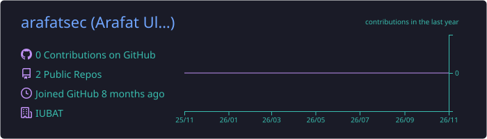

<!-- Header -->
<p align="center">
  
</p>

<p align="center">
  <a href="https://github.com/arafatsec">
    
  </a>
</p>

<p align="center">
  
  
  
  
</p>

---

### 🧑‍💻 About me

```python
class Arafat:
    name      = "Arafat Ul Islam"
    role      = "IT Automation Specialist @ IUBAT (IT Automation Office · IIEC-IUBAT)"
    location  = "Dhaka, Bangladesh 🇧🇩"
    speaks    = ["Bangla", "English"]

    builds    = ["university platforms", "OMR exam grading", "ID & identity systems",
                 "attendance & HR automation", "edge devices on Raspberry Pi"]
    secures   = ["web apps", "production servers", "the networks people rely on"]
    measures  = "internet shutdowns, throttling and blocking in Bangladesh"
    writing   = "a journal paper on open-source OMR for large-scale admission tests"

    principles = [
        "If a human does it twice, automate it.",
        "If it's exposed, test it.",
        "Learn from prior art; write the implementation from scratch.",
        "Measure on real data before calling it done.",
    ]
```

### 🚀 Right now

- 🏛️ **IUBAT-OS**: a modular university automation platform (Django + Next.js) that replaces paper and legacy PHP, one department at a time. Leave management is the first module live.
- 📝 **Admission Marking System**: computer-vision grading of OMR answer sheets for admission tests with **2,000–3,000 candidates**, replacing roughly **250 person-hours** of hand marking per session. It uses two-station ADF scanning, a confidence-scored review queue and a full audit trail.
- 📄 **Research**: *Comparative Study and Original Implementation of an Open-Source OMR System for Large-Scale University Admission Tests: Design, Deployment, and Accuracy Analysis at IUBAT* (in preparation).
- 🌐 **bd-network-observatory**: independent, blackout-resilient measurement of internet shutdowns in Bangladesh.

### 🏗️ Systems I've built

| | System | What it does | Stack |
|:-:|---|---|---|
| 📝 | **Admission Marking System (OMR)** | Original OMR engine: fiducial alignment, QR identity with HMAC, bubble classification calibrated on real scans, reviewer dashboard, merit exports | OpenCV · Django · Celery · Next.js · PostgreSQL · MinIO |
| 🏛️ | **IUBAT-OS** | University automation platform; leave management replacing a legacy PHP system | Django 5 · DRF · Next.js 15 · Docker |
| ⏱️ | **Attendance reporting** | Daily employee attendance from face-recognition terminals into department-wise PDF reports | Python · Hikvision HikCentral |
| 🎓 | **Course enrollment** | Real-time enrollment built for **15,000 concurrent students**, with queue-based fair seat allocation | TypeScript · queues |
| 🪪 | **Student ID card system** | Card generation, printing, staff dashboard and QR verification | Django · Python |
| 📸 | **Volume photo capture** | Offline-first capture across **8 networked DSLR stations** for **9,000+ students** | Python |
| 🧠 | **Face-terminal photo prep** | GPU pipeline that prepares enrollment photos for face-recognition terminals | RetinaFace · ArcFace · PyTorch |
| 🍽️ | **Canteen management (LLCMS)** | Ordering and point-of-sale for the campus canteen | Django · Python |
| 🤖 | **Setu desk robot** | Offline Bangla ↔ English voice translator and front-desk assistant | Raspberry Pi 5 · Python |
| 🩸 | **Verify** | Student blood-group collection and information verification | Django |
| 🪟 | **Window automation** | Recovered and now maintained for IIEC-IUBAT | Python |

<sub>These are internal university systems, so their repositories are private.</sub>

### 🧪 Side projects

- ✋ **AirWords**: gesture-controlled learning games with personal learning journeys, bilingual activities and cooperative missions
- 📚 **Paper to Screen**: turns openly licensed children's picture books into animated videos
- 🎌 **Real to Anime**: real video into anime-style 9:16 clips (WAN 2.2 + ComfyUI)
- 🍛 **Cafeteria image pipeline**: 88 dish images from Excel-driven prompts (Flux + ComfyUI)
- 🛒 **AppleItem**: bilingual gadget e-commerce store with admin panel (Next.js 16, Prisma, Tailwind)

### 🤝 Community

**Chatlarpar Horizon School & Foundation**: bilingual (English / বাংলা) websites for a community school project in Chatlarpar, Ulipur, Kurigram.

### ⚡ Tech stack

<p align="center">
  <b>Languages</b><br/>
  
</p>
<p align="center">
  <b>Backend · Data</b><br/>
  
</p>
<p align="center">
  <b>Frontend</b><br/>
  
</p>
<p align="center">
  <b>CV · ML · Hardware</b><br/>
  
</p>
<p align="center">
  <b>Infra · Tools</b><br/>
  
</p>
<p align="center">
  
  
  
  
  
  
  
  
</p>

### 🔐 Security toolkit

<p align="center">
  
  
  
  
  
  
  
  
  
  
</p>

<p align="center"><sub>Server hardening and audits · web application testing · bug bounty (HackerOne / Bugcrowd) · network measurement</sub></p>

### 📌 Featured

<table align="center">
  <tr>
    <td>
      <h3>🌐 <a href="https://github.com/arafatsec/bd-network-observatory">bd-network-observatory</a></h3>
      Independent, blackout-resilient measurement of internet shutdowns, throttling and blocking in Bangladesh.<br/><br/>
      
      
      
      
    </td>
  </tr>
</table>

### 📊 GitHub

<p align="center">
  
</p>
<p align="center">
  
</p>

<p align="center">
  <picture>
    <source media="(prefers-color-scheme: dark)" srcset="https://raw.githubusercontent.com/arafatsec/arafatsec/output/snake-dark.svg" />
    <source media="(prefers-color-scheme: light)" srcset="https://raw.githubusercontent.com/arafatsec/arafatsec/output/snake-light.svg" />
    
  </picture>
</p>

<!-- Footer -->
<p align="center">
  
</p>
